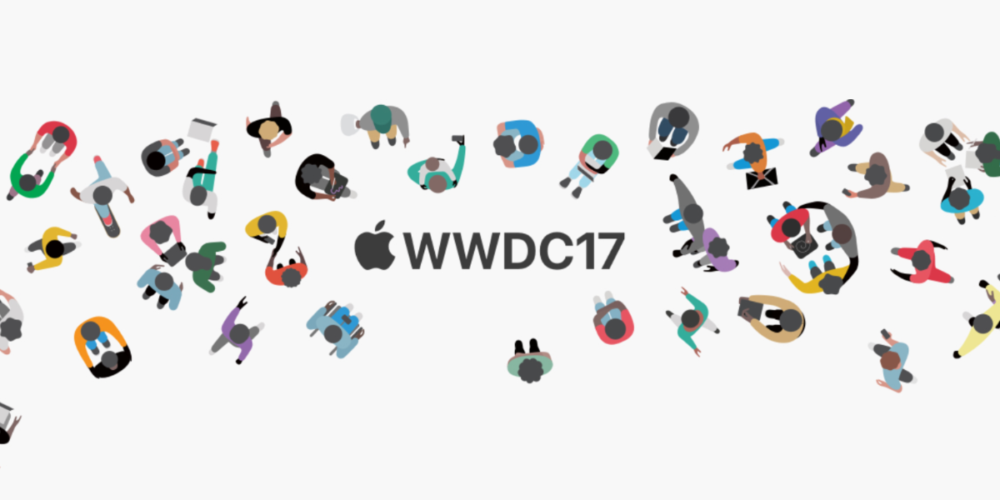

# WWDC 2017 - Scholarship

List of student submissions for the WWDC 2017 - Scholarship. The list is in alphabetical order.

### How to add your submission?
1. **[Click here to open the form](https://github.com/wwdc/2017/issues/new?template=submit.yml)** and fill it in.
2. Send it. A bot checks your entry within a minute and tells you if anything needs fixing. You can edit the form after sending.
3. When it is approved your entry appears on this list.

#### How to update or remove your submission?
Use the **[update form](https://github.com/wwdc/2017/issues/new?template=update.yml)**. Only the person who sent the entry can change it.

### Submissions

| Participant | Links | Status |
|:--|:--|:--|
| [Aalap Patel](https://github.com/aalap07) | [GitHub](https://github.com/aalap07/wwdc.git) UIKit, AVFoundation, PlaygroundSupport, CoreGraphics |  |
| [Aaron Cheung](https://github.com/AaronCheung430) | [GitHub](https://github.com/AaronCheung430/WWDC2017) · [Video](https://youtu.be/OFgC1uoggXE) UIKit, AVFoundation, PlaygroundSupport, SceneKit |  |
| [Adrián Rubio](https://github.com/Adrxx) | [GitHub](https://github.com/Adrxx/Amatheus.git) · [Video](https://youtu.be/Pe4V74afBS8) SpriteKit, AVFoundation |  |
| [Agisilaos Tsaraboulidis](https://github.com/agisilaos) | SpriteKit, AVFoundation, GameplayKit |  |
| [Albert Sanchez](https://github.com/AlbertSanIza) | [GitHub](https://github.com/AlbertSanIza/CodedWithLove) SpriteKit, AVFoundation, GameplayKit |  |
| [Alberto Saltarelli](https://github.com/alberto093) | [GitHub](https://github.com/alberto093/CodingNotes) · [Video](https://www.youtube.com/watch?v=AtFOH-BCje0) UIKit, AVFoundation, AudioToolbox |  |
| [Alexandre Vassinievski Ribeiro](https://github.com/alexvassini) | [GitHub](https://github.com/alexvassini/Drawing-with-playground-WWDC2017-Scholarship) · [Video](https://www.youtube.com/watch?v=fqbxTRz5aO4) UIKit, CoreMotion, PlaygroundBooks |  |
| [Alexandro Luongo](https://w00dl3cs.github.io) | [GitHub](https://github.com/W00dL3cs/Super-Maze) UIKit, SpriteKit, CoreMotion, PlaygroundSupport |  |
| [Aline K Borges](https://github.com/alinekborges) | [GitHub](https://github.com/alinekborges/DancingFractals) · [Video](https://youtu.be/cq8lz5rzp4M) UIKit, PlaygroundBooks |  |
| [Aman Jain](https://linkedin.com/in/aman-jain-4a589b8a/) | [Video](https://www.youtube.com/watch?v=buh1C8aYki8) SpriteKit, AVFoundation, Swift Playground |  |
| [Amanda Southworth](https://github.com/thecodingone) | [GitHub](https://github.com/thecodingone/solar-system) UIKit, CoreAnimation |  |
| [Ana Carolina Barreto](https://github.com/acrlnb) | [Video](https://www.youtube.com/watch?v=8uW5E_UVuuU) SpriteKit |  |
| [Andrew Abosh](https://github.com/aabosh) | [Video](https://youtu.be/MqaLxoWBipI) UIKit, SpriteKit |  |
| [Antoine Bellanger](https://github.com/antbelldev) | [GitHub](https://github.com/antbelldev/RSAPlayground) UIKit |  |
| [Antonio Antonino](https://github.com/Diiaablo95) | [GitHub](https://github.com/Diiaablo95/WWDC17) · [Video](https://www.youtube.com/watch?v=Oxh8Mllld_k) UIKit, CoreImage, PlaygroundSupport |  |
| [Antonio Zaitoun](https://github.com/Minitour) | [GitHub](https://github.com/Minitour/The-Macintosh-Project) · [Video](https://www.youtube.com/watch?v=xsI5CaudNbQ) UIKit, CoreGraphics, CoreAnimation, Gesture Recognizer +1 |  |
| [Anushk Mittal](http://anushk.me) | [GitHub](https://github.com/anushkmittal/bankCEO) UIKit, CoreGraphics, CoreAnimation, PlaygroundBook |  |
| [Arjun Naha](https://github.com/arjunnaha/) | UIKit, SpriteKit, AVFoundation |  |
| [Arved Viehweger](https://github.com/arvedviehweger/) | [GitHub](https://github.com/arvedviehweger/WWDC17-Playground) · [Video](https://www.youtube.com/watch?v=o0tvrlHkuoA&) UIKit, SpriteKit, AVFoundation, CoreGraphics |  |
| [Aviral Aggarwal](https://www.facebook.com/Aviral190694) | [GitHub](https://github.com/Aviral190694/WWDC-2017-Application-Selected-Happoji) UIKit, SpriteKit |  |
| [Ayush Aggarwal](https://highestage.github.io) | UIKit, PlaygroundSupport, CoreAudio, Metal +7 |  |
| [Ben Emdon](https://github.com/BenEmdon) | [GitHub](https://github.com/BenEmdon/PixelArtMaker) UIKit |  |
| [Benjamin Herzog](https://github.com/BenchR267) | [GitHub](https://github.com/BenchR267/Get-Schwifty) · [Video](https://github.com/BenchR267/Get-Schwifty/raw/master/img/live.gif) UIKit, Foundation |  |
| [Bradley Mackey](https://github.com/bradleymackey/) | [GitHub](https://github.com/bradleymackey/WWDC-2017) · [Video](https://youtu.be/Hzs8zHOiZQM) UIKit, CoreAnimation |  |
| [Brett Fazio](https://github.com/brettfazio/) | [GitHub](https://github.com/brettfazio/WWDC17-Winning-Submission) UIKit, SpriteKit, PlaygroundSupport |  |
| [Caleb Kierum](https://github.com/CalebKierum) | [GitHub](https://github.com/CalebKierum/WWDC-2017-Elevator) SpriteKit |  |
| [Chan Jing Hong](https://twitter.com/cJinghong) | [GitHub](https://github.com/cjinghong/EvanWonderland) · [Video](https://youtu.be/zu3s-87s_AA) UIKit |  |
| [Charles Ferreira](https://www.facebook.com/CharlesFerreiraDev) | [GitHub](https://github.com/charles6286/RainbowFluid) · [Video](https://youtu.be/7duJDyI_epQ) SpriteKit, PlaygroundSupport |  |
| [Charles Truluck](https://twitter.com/CharlesTruluck_) | [GitHub](https://github.com/charlestruluck/WWDC17) SceneKit, UIKitDynamics, CoreAnimation |  |
| [Christian Schnorr](https://github.com/jenox) | [GitHub](https://github.com/jenox/Force-Directed-Graph-Drawing) Swift, UIKitDynamics |  |
| [Clemens Brockschmidt](https://github.com/cbrockschmidt/) | [GitHub](https://github.com/cbrockschmidt/wwdc17) SpriteKit, UIKit |  |
| [Daniel Kuntz](https://twitter.com/danielkuntz0) | [GitHub](https://github.com/dkun7944/os-ios/tree/master/Playground) AudioKit, CoreGraphics, Gesture Recognizer |  |
| [Danny M](https://github.com/dannymout) | [GitHub](https://github.com/dannymout/WWDC17) UIKit, AVFoundation, PlaygroundSupport |  |
| [Darius Kuddo](http://lumentie.com) | [Video](https://youtu.be/VcKMo0UMe-E) MetalKit, Accelerate, AVFoundation, SIMD Vector Library |  |
| [David Nadoba](https://twitter.com/DNadoba) | [GitHub](https://github.com/dnadoba/snake-playgroundbook) · [Video](https://youtu.be/fs60kMa0Of4) UIKit, AVFoundation |  |
| [Davide Sibilio](http://twitter.com/iDevid) | [Video](https://www.youtube.com/watch?v=VAinhEco1mY) UIKit, CoreAnimation, PlaygroundBook |  |
| [Dominik Rygiel](https://twitter.com/Antoszku) | [GitHub](https://github.com/Antoszku/I-Love-Hue-WWDC-2017) · [Video](https://youtu.be/VPtqDciPShI) UIKit |  |
| [Emannuel Carvalho](http://twitter.com/emannuel_oc) | [GitHub](https://github.com/emannuelOC/wwdc2017/tree/master) PlaygroundBook, NSLinguisticTagger, DynamicAnimator, CoreAnimations +1 |  |
| [Eremenko Maxim](https://www.linkedin.com/in/maxim-eremenko/) | [GitHub](https://github.com/devMEremenko/WWDC) · [Video](https://www.youtube.com/watch?v=B7LpHhujz4U&t=2s) MVVM, CoreAnimations, InteractiveTransitions |  |
| [Erik Maximilian Martens](https://www.linkedin.com/in/erik-maximilian-martens-212280a1/) | [GitHub](https://github.com/erikmartens/WWDC-2017-Scholarship-Submission) UIKit |  |
| [Eytan Schulman](https://twitter.com/eytanschulman) | [Video](https://youtu.be/p0xSkfTZV0c) SpriteKit, AVFoundation, Swift Playgrounds, CoreGraphics +2 |  |
| [Filipe Alvarenga](https://github.com/filipealva) | [GitHub](https://github.com/filipealva/WWDC17-Scholarship) UIKit, PlaygroundSupport |  |
| [Filipe Nogueira Jordão](https://github.com/FilipeJrd) | [GitHub](https://github.com/FilipeJrd/DijkstraSimulator) · [Video](https://www.youtube.com/watch?v=KcyJmsUFPBE&feature=youtu.be) UIKit, PlaygroundSupport |  |
| [Florian Kasten](https://github.com/Flokkka) | [GitHub](https://github.com/Flokkka/Lists-SwiftPlayground) UIKit, PlaygroundSupport, CoreGraphics |  |
| [Gabriel Cavalcante](https://github.com/gabrielsscavalcante) | [Video](https://youtu.be/gaoKRjBLQfQ) UIKit, AVFoundation, CoreImage, NSLayoutContraint +1 |  |
| [Galal Hassan](https://galalhassan.com) | [GitHub](https://github.com/galalmounir/WWDC-2017-Entry) SpriteKit |  |
| [Gautham Elango](https://gauthamelango.com/) | [Source](https://git.gcubed.co/wwdc2017/) Swift, SpriteKit, UIKit, Machine Learning +1 |  |
| [Giuseppe D'Onofrio](https://www.linkedin.com/in/giuseppe-d-onofrio-b78390144/) | [GitHub](https://github.com/DonPex/WWDC2017) UIKit, AVFoundation, SpriteKit |  |
| [Guoye Zhang](https://d0g.cc) | [GitHub](https://github.com/cc941201/WWDC2017-SAT) PlaygroundBook, Storyboard |  |
| [Guozheng Zhang](https://github.com/Daniel612) | [GitHub](https://github.com/Daniel612/Homeland) SceneKit, UIKit, AVFoundation |  |
| [Hammad Jutt](http://jutt.ca) | [GitHub](https://github.com/hammadj/Swift-2048-AI) · [Video](https://media.giphy.com/media/oczwr8lzNwOdy/giphy.gif) UIKit, CoreAnimation |  |
| [Hari](https://www.twitter.com/developerHari) | SceneKit, UIKit, CoreMotion |  |
| [Harish Yerra](https://twitter.com/harishyerra4) | CoreImage, Metal |  |
| [Harshil Shah](https://github.com/HarshilShah) | [GitHub](https://github.com/HarshilShah/Watchface) UIKit, CoreGraphics, SpriteKit |  |
| [Hengyu](https://twitter.com/hengyuy) | [GitHub](https://github.com/hengyu/Mother) · [Video](https://www.youtube.com/watch?v=J8LLSW4Ubvg) SpriteKit, SceneKit, CoreAnimation, UIKit |  |
| [Henrik Storch](https://twitter.com/thisisthefoxe) | [GitHub](https://github.com/thisIsTheFoxe/WWDC17) · [Video](https://www.youtube.com/watch?v=5bwNn5vzg10) SpriteKit, UIKit |  |
| [Hollis Liu](https://twitter.com/hollis0807) | [GitHub](https://github.com/hollisliu/Spacetime-Rhapsody) · [Video](https://github.com/hollisliu/Spacetime-Rhapsody/blob/master/intro.gif) SceneKit, UIKit, PlaygroundSupport |  |
| [Ishaan Prasad](http://www.ishaanprasad.com) | UIKit, PlaygroundSupport, GaemplayKit, MapKit |  |
| [Jack Bruienne](http://jackmacwindows.tumblr.com/) | [GitHub](https://github.com/MCJack123/WWDC-2017-Clock) · [Video](https://68.media.tumblr.com/b50892b1b85a8b21addf3972a0629a5f/tumblr_onj56lPSp01w8q2b8o1_1280.gif) UIKit, Timers |  |
| [Jack Chorley](https://github.com/jdjack) | [GitHub](https://github.com/jdjack/WWDC2017Scholarship) UIKit, SpriteKit, Genetic Algorithm, Generics |  |
| [Jai Bhavnani](https://github.com/jbhav24) | [GitHub](https://github.com/jbhav24/WWDC-2017-Scholarship-Playground) Gesture Recognizer, CoreAnimation, SpriteKit, UIKit +3 |  |
| [Jari Koopman](https://github.com/MrLotU/) | [GitHub](https://github.com/MrLotU/WWDC17) UIKit, PlaygroundSupport |  |
| [Jay Lees](https://github.com/jaylees14) | [GitHub](https://github.com/jaylees14/wwdc17) UIKit, SceneKit, AVFoundation, PlaygroundSupport |  |
| [Jinghan Wang](https://github.com/null09264) | GameplayKit, SpriteKit, CoreMotion, AVFoundation +1 |  |
| [Joel Rorseth](https://github.com/joelrorseth/) | [GitHub](https://github.com/joelrorseth/Tree-Trouble) GameplayKit, Social, SpriteKit, PlaygroundSupport +1 |  |
| [John Harding](http://hardingsoftware.co) | [Video](https://www.youtube.com/watch?v=RQomb8R8kMc&feature=youtu.be) SpriteKit, AVFoundation, GameKit |  |
| [Jordan Osterberg](https://twitter.com/osterbergjordan) | [GitHub](https://github.com/JordanOsterberg/wwdc/tree/master/2017/WWDC17.playground) SpriteKit, CoreMotion |  |
| [Jose Antonio González](https://github.com/josegrobles) | [GitHub](https://github.com/josegrobles/WWDC2017/) SpriteKit, SceneKit, QuartzCore, PlaygroundBook |  |
| [Juan David Cruz](https://juandavidcruz.com) | [GitHub](https://github.com/juandavidcruzs/ABitOfHumanity) SpriteKit, UIKit, CoreAnimation, AVFoundation +3 |  |
| [Júnior Lima](https://github.com/juniorlimaivd) | [GitHub](https://github.com/Juniorlimaivd/LaunchPad-Playground) UIKit, AVFoundation |  |
| [Kabir Oberai](https://twitter.com/kabiroberai) | [GitHub](https://github.com/kabiroberai/wwdc-17) AVFoundation, CoreGraphics, SpriteKit |  |
| [Kamil Kosowski](https://www.facebook.com/kamil.kosowski.75641) | [Source](https://www.youtube.com/watch?v=9Ny6gaTcpd4&t=1s) UIKit, CoreAnimation, AVFoundation |  |
| [Kervon Ryan](https://github.com/kervonryan) | Swift, UIKit, SpriteKit, PlaygroundSupport |  |
| [Kevin Turner](https://www.kevinturnerapps.com) | [GitHub](https://github.com/kevtheappdev) UIKit |  |
| [Klemens Strasser](http://klemensstrasser.at) | [Video](https://www.youtube.com/watch?v=xFFonp640j4) SpirteKit, UIKit |  |
| [Krish Wadhwana](https://www.pointblanc.tech) | [GitHub](https://github.com/krishwadhwana) UIKit |  |
| [Kush Taneja](https://www.facebook.com/kushtaneja16) | [GitHub](https://github.com/kushtaneja/WWDC-2017/) · [Video](https://youtu.be/tgVCUV37TqE) UIKit, SpriteKit, CoreAnimation, AVFoundation +3 |  |
| [Kyle Johnson](http://kylejohnsonapps.com) | [Video](https://www.youtube.com/watch?v=lHKf4klk0-I) UIKit, SpriteKit, PlaygroundSupport, AVFoundation |  |
| [Kyle Spadaro](https://twitter.com/kylespadaro) | [GitHub](https://github.com/kylespadaro2/WWDC/tree/master/2017) GameKit, GameplayKit, ReplayKit, SpriteKit +1 |  |
| [Lalo Martínez](https://twitter.com/L__A__L__O) | [GitHub](https://github.com/LaloMrtnz/Kaleido) · [Video](https://www.youtube.com/watch?v=6XYdC8IKNus&t=3s) CoreAnimation, AVFoundation |  |
| [Léo Vallet](https://github.com/leovallet) | [GitHub](https://github.com/leovallet/WWDC-2017) SpriteKit, AVFoundation, AVSpeechSynthesizer |  |
| [Logan Henderson](https://twitter.com/0logn) | [GitHub](https://github.com/LoganHenderson/WWDCScholarship2017) UIKit, CoreImage, AVFoundation |  |
| [Maciej Gomółka](https://github.com/Zaprogramiacz) | [GitHub](https://github.com/Zaprogramiacz/PixelBalls-WWDC2017) · [Video](https://www.youtube.com/watch?v=Q45fAN7E5WI) XCTest, CoreAnimation, AVFoundation, UIKit |  |
| [Marko Crnkovic](https://github.com/chih98) | [GitHub](https://github.com/chih98/wwdc2017) · [Video](https://www.youtube.com/watch?v=DLGU4SeUDBA) AudioToolbox, UIKit, PlaygroundSupport |  |
| [Martin Lücke](https://github.com/redtoastyDev) | [GitHub](https://github.com/redtoastyDev/WWDC17-Scholarship-submission) SpriteKit, UIBezierPath, AVFoundation, CoreGraphics |  |
| [Matheus Cardoso](https://github.com/cardoso) | [GitHub](https://github.com/cardoso/AutoPong) SpriteKit, PlaygroundBooks |  |
| [Matthijs Logemann](https://github.com/matthijs2704) | [GitHub](https://github.com/matthijs2704/wwdc2017) · [Video](https://youtu.be/N2ETuXQk9QU) SpriteKit, Swift Playgrounds (iOS), HTML, UIKit |  |
| [Michael Galperin](https://github.com/piechart) | [GitHub](https://github.com/piechart/WWDC17-Submission) UIKit, AVFoundation, CoreAnimation, CoreGraphics +2 |  |
| [Miguel Salinas](https://github.com/idevMike) | [GitHub](https://github.com/idevMike/WWDC-2017-Scholarship-Application-Playground) · [Video](https://www.youtube.com/watch?v=5ELtImUl3SU) AVFoundation, SpriteKit |  |
| [Mitchell Sweet](http://www.mitchellsweet.com) | [Video](https://www.youtube.com/watch?v=sZf_62qixPQ) SpriteKit, UIKit |  |
| [Mohamed Salah](https://www.facebook.com/Abo.Salahh77) | [GitHub](https://github.com/MoHamEdSaLaHH/WWDC17-Scholarship-Submission) · [Video](https://www.youtube.com/watch?v=wUSoqkv4IJg&list=PLl469UE7Uwr0bdon2CvnpxmQs16qu4nkf&index=8) SceneKit, AVFoundation, UIKit |  |
| [Moritz Sternemann](https://github.com/moritzsternemann) | [GitHub](https://github.com/moritzsternemann/SwipyCell/tree/master/PlaygroundBook) PlaygroundBook, UIKit, SwipyCell, HTML |  |
| [Nakul Bajaj](https://github.com/nakulbajaj) | [GitHub](https://github.com/nakulbajaj/Nakul-Bajaj-WWDC-17-Submission) UIKit, SceneKit, CoreGraphics, CoreAnimation +1 |  |
| [Neil Sardesai](https://github.com/neilsardesai) | [GitHub](https://github.com/neilsardesai/WWDC-Crowd-Simulator-2017) SpriteKit |  |
| [Nicholas G](https://github.com/Nicholas714) | [GitHub](https://github.com/Nicholas714/WWDC-2017) · [Video](https://youtu.be/XJAqi6bqZW4) SceneKit, SpriteKit, UIKit |  |
| [Nikita Pankiv](https://github.com/nikitapankiv) | [GitHub](https://github.com/nikitapankiv/WWDC-17) UIKit, CoreGraphics, AVFoundation |  |
| [Nils Leif Fischer](http://nilsleiffischer.de) | [GitHub](https://github.com/knly/black-holes-playground) SpriteKit, CoreImage, CoreMotion, AVFoundation |  |
| [Omar Droubi](https://www.linkedin.com/in/omardroubi) | [GitHub](https://github.com/omardroubi/UrbanEarth-Apple-WWDC17-Scholarship-Submission) · [Video](https://youtu.be/4--weHli8Js) UIKit, SceneKit, AVFoundation, CoreAnimation +1 |  |
| [Orlando Aprea](https://github.com/ooorlandooo) | [GitHub](https://github.com/ooorlandooo/WWDC-2017-Playground) SpriteKit, AVFoundation |  |
| [Pannatier Arnaud](https://github.com/ArnaudPannatier) | [GitHub](https://github.com/ArnaudPannatier/Solitaire-Playground) UIKit |  |
| [Patrick Balestra](https://github.com/BalestraPatrick) | [GitHub](https://github.com/BalestraPatrick/WWDC-2017-Scholarship) · [Video](https://www.youtube.com/watch?v=6gsqjLKMYiE&feature=youtu.be) SceneKit, AppKit |  |
| [Philipp Gabriel](https://github.com/ph1ps) | [GitHub](https://github.com/ph1ps/WWDC17) UIKit, Algorithms |  |
| [Philippe Yu](https://github.com/philippejlyu) | CoreAnimation, AVFoundation |  |
| [Pietro Caruso](https://www.facebook.com/pietro.caruso.16) | [GitHub](https://github.com/ITzTravelInTime/playgoundOS) JavaScriptCore, UIKit, SpiteKit, WebKit +3 |  |
| [Qingyang Hu](https://github.com/mmlmml1) | [GitHub](https://github.com/mmlmml1/IntroducingAccelerometer) UIKit, CoreMotion, ToolBox, PlaygroundSupport +1 |  |
| [Rahul M](https://twitter.com/rahulmfg) | [GitHub](https://github.com/Getmrahul/WWDC-2017) SpriteKit, UIKit, AVFoundation |  |
| [Raul Marques](https://github.com/raulmo1337) | [Video](https://youtu.be/WPaGzKoPJoA) UIKit, AVFoundation, UIDynamics, CoreAnimation |  |
| [Rehaan Advani](https://twitter.com/Rehaan_Advani) | [Video](https://www.youtube.com/watch?v=hAmEIQkCZg0) UIKit, MapKit, PlaygroundSupport, CoreAnimation +2 |  |
| [Remy Da Costa Faro](https://github.com/RemyDCF) | [GitHub](https://github.com/RemyDCF/WWDCPlayground/) · [Video](https://www.youtube.com/watch?v=UgsFoo7QDZs) SpriteKit, AVFoundation |  |
| [Renata Faria](https://github.com/xReee) | [Video](https://youtu.be/P0qTka4s5zM) UIKit, NSLayoutConstraint, Gesture Recognizer |  |
| [Richter Brzeski](https://github.com/richtermb) | [GitHub](https://github.com/richtermb/WWDC-2017) · [Video](https://ibb.co/jzUvT5) UIKit, Accelerate, QuartzCore, Foundation +2 |  |
| [Rodrigo Longhi Guimarães](https://github.com/rodrigolguimaraes) | [GitHub](https://github.com/RodrigoLGuimaraes/SpaceNomad_wwdc17) · [Video](https://youtu.be/e4wxhQbj_8E) SpriteKit, UIKit, AVFoundation |  |
| [Rohit Gurnani](https://github.com/rkgi10) | [Video](https://www.youtube.com/watch?v=pcWb8Nsem9U) SpriteKit, AVFoundation |  |
| [Ronak Shah](https://ronakshah.net) | [GitHub](https://github.com/ronakdev/spacecoders) SpriteKit |  |
| [Ross Freeman](https://github.com/rfree18) | [GitHub](https://github.com/rfree18/WWDC2017) UIKit, AVFoundation, CoreAnimation |  |
| [Ryan O'Connor](https://twitter.com/ryan7oconnor) | [GitHub](https://github.com/ryanoconnor7/WWDC-2017-Scholarship-Application) · [Video](https://youtu.be/vu6X3VcbNa4) AVFoundation, CoreMotion, UIKit, SpriteKit +3 |  |
| [Sai Kambampati](https://twitter.com/Sai_K1065) | [GitHub](https://github.com/theindiandev1065/WWDC-2017-Scholarship) · [Video](https://www.youtube.com/watch?v=knuZbeqisN0) UIKit, CoreGraphics, CoreAnimation |  |
| [Salman Husain](https://twitter.com/aeroxtwo) | [GitHub](https://github.com/shusain93/WWDC17/) · [Video](https://www.youtube.com/watch?v=dRcC0TVG4tc) SpriteKit, PlaygroundBook, SpeechSynth |  |
| [Sam Eckert](https://twitter.com/sam0711er) | [Video](https://youtu.be/xnhBQ9YeOJ0) SpriteKit, PlaygroundBook, AVKit, AVFoundation +1 |  |
| [Shunzhe Ma](https://twitter.com/shunzhema) | [GitHub](https://github.com/shunzhema/WWDC17) · [Video](https://www.youtube.com/watch?v=wpSRApiUfEI&t=9s&index=19&list=PLl469UE7Uwr0bdon2CvnpxmQs16qu4nkf) SceneKit, PlaygroundBook, CoreAnimation, CoreGraphics +3 |  |
| [Stephen Heaps](https://twitter.com/StephenHeaps) | [GitHub](https://github.com/StephenHeaps/WWDC17Playground) UIKit, UIKit Dynamics, UIKit Animation, CoreAnimation |  |
| [Stergios Hetelekides](https://github.com/hetelek) | [GitHub](https://github.com/hetelek/Neural-Network-Playground) UIKit, PlaygroundSupport, CoreGraphics |  |
| [Taras Nikulin](https://ru-ru.facebook.com/people/Taras-Nikulin/100000793231499) | [GitHub](https://github.com/crabman448/Dijkstra-algorithm) · [Video](https://www.youtube.com/watch?v=PPESI7et0cQ&feature=youtu.be) UIKit, BezierPath, Algorithms, PlaygroundSupport |  |
| [Thomas Naudet](https://twitter.com/tomn94) | [GitHub](https://github.com/Tomn94/WWDC-2017-Scholarship) · [Video](https://youtu.be/w5SfOVPmK_U) SceneKit, SpriteKit, Core Motion/Animation/Graphics, AVFoundation +4 |  |
| [Tianyue Gao](https://twitter.com/VeeGeeApps) | [GitHub](https://github.com/Phacometer/Giddy-Guitar-wwdc17scholarship) · [Video](https://youtu.be/CaGphUNQVr8) UIKit, CoreAnimation, CoreGraphics, AVFoundation +1 |  |
| [Tiziano Coroneo](https://www.facebook.com/tizianocoroneo) | [GitHub](https://github.com/TizianoCoroneo/WWDC2017---Memefield.git) SpriteKit, GameplayKit |  |
| [Tyler Angert](https://www.tylerangert.com) | [GitHub](https://github.com/tangert/WWDC17) · [Video](https://www.youtube.com/watch?v=0fhUBMSI8Yw&feature=youtu.be) UIKit Dynamics, CoreMotion, CoreAnimation |  |
| [Vegard Solheim Theriault](https://twitter.com/vegather) | [GitHub](https://github.com/vegather/A-World-of-Circles) PlaygroundBook, CoreAnimation, CoreGraphics, Fourier Transform |  |
| [Vincent Cai](http://www.facebook.com/vince14genius) | [GitHub](https://github.com/Vince14Genius/My-WWDC-Scholarship-Submissions/tree/master/WWDC17) SpriteKit, PlaygroundSupport |  |
| [Weiran Du](http://www.williamdu.space) | UIKit, AVFoundation, Minimax, PlaygroundSupport +1 |  |
| [William Taylor](http://wttech.tk) | [Video](https://youtu.be/PMhMg8TDrow?list=PLl469UE7Uwr0bdon2CvnpxmQs16qu4nkf) SpriteKit, AVFoundation, UIKit |  |
| [William Zhang](https://github.com/17zhangw/) | [GitHub](https://github.com/17zhangw/WWDC2017) SpriteKit, UIKit, PlaygroundSupport, AVFoundation |  |
| [Yana Valieva](https://github.com/vJenny) | [GitHub](https://github.com/vJenny/reversi-game) CoreGraphics, UIKit, PlaygroundSupport |  |
| [Yifei He](http://www.arefly.com/) | [Video](https://youtu.be/L26UgWbwZFM) CoreBluetooth, SpriteKit, UIKit, PlaygroundSupport |  |
| [Zach Simone](https://twitter.com/zachsimone) | [GitHub](https://github.com/zachsimone/WWDC17-Scholarship-Application) SpriteKit, UIKit |  |
| [Zhiyu Zhu](https://twitter.com/zhuzhiyu2001041) | [GitHub](https://github.com/ApolloZhu/Swifty-Karel) Singleton, Timer, UIKit and Animation, CoreGraphics +3 |  |
| [Ziga Besal](http://ekranac.com) | [GitHub](https://github.com/ekranac/Zboot-Playground) UIKit |  |

##### Total: 137 | Awarded: 90
